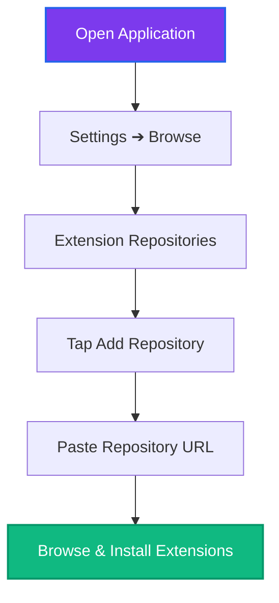

# <p align="center">AniZen & Aniyomi Extension Repository</p>

<p align="center">
  <a href="https://raw.githubusercontent.com/salmanbappi/extensions-repo/main/index.min.json">
    
  </a>
  <a href="https://github.com/salmanbappi/sb-extensions-source/actions/workflows/build_push.yml">
    
  </a>
  <a href="https://discord.gg/G6g4vBmcXp">
    
  </a>
  <a href="https://github.com/salmanbappi/extensions-repo">
    
  </a>
</p>

<p align="center">
  Official distribution repository for <b>AniZen</b> and <b>Aniyomi</b> custom extension packages.<br>
  Compiled, verified, cryptographically signed, and deployed automatically via remote GitHub Actions CI.
</p>

---

## 📲 Setup Guide

Add this repository to your app in a few quick steps:



### Repository URLs

Depending on your client, you can use any of the following endpoints:

| Format / Target | URL |
| :--- | :--- |
| **Primary Index** | `https://raw.githubusercontent.com/salmanbappi/extensions-repo/main/index.min.json` |
| **Metadata Endpoint (`repo.json`)** | `https://raw.githubusercontent.com/salmanbappi/extensions-repo/main/repo.json` |
| **Web Catalog** | [https://salmanbappi.github.io/extensions-repo/](https://salmanbappi.github.io/extensions-repo/) |

#### Instructions:
1. Open **AniZen** or **Aniyomi**.
2. Navigate to **Settings** ➔ **Browse** ➔ **Extension repositories**.
3. Tap **Add repository** (+ icon) and paste the Primary Index URL:
   ```text
   https://raw.githubusercontent.com/salmanbappi/extensions-repo/main/index.min.json
   ```
4. Head back to the **Extensions** tab to search, install, and update your sources.

---

## 💬 Community & Support

Need assistance, want to request an extension, or looking to report a broken source? Join our official Discord community:

<p align="center">
  <a href="https://discord.gg/G6g4vBmcXp">
    
  </a>
</p>

---

## 🛠️ Repository Specifications

| Specification | Value / Details |
| :--- | :--- |
| **Source Monorepo** | [salmanbappi/sb-extensions-source](https://github.com/salmanbappi/sb-extensions-source) |
| **Distribution Repo** | [salmanbappi/extensions-repo](https://github.com/salmanbappi/extensions-repo) |
| **API Architecture** | Extensions-lib API v16 baseline (Aniyomi v14–v17 & AniZen compatible) |
| **Languages Supported** | English (`en`), Bangla / BDIX (`bn`), Multi-language (`all`), Arabic (`ar`), Spanish (`es`) |
| **Automation Engine** | Fully automated remote CI/CD via GitHub Actions (`build_push.yml`) |
| **Signing Protocol** | Android APK v2/v3 scheme with SHA-256 trust pinning |

---

## ⚙️ Maintenance & Lifecycle

Extension packages and indices are rebuilt automatically on every commit to the source repository. Upstream changes trigger compilation, Dex code inspection (`Inspector.jar`), icon normalization, and SHA-256 fingerprint validation before deployment.
